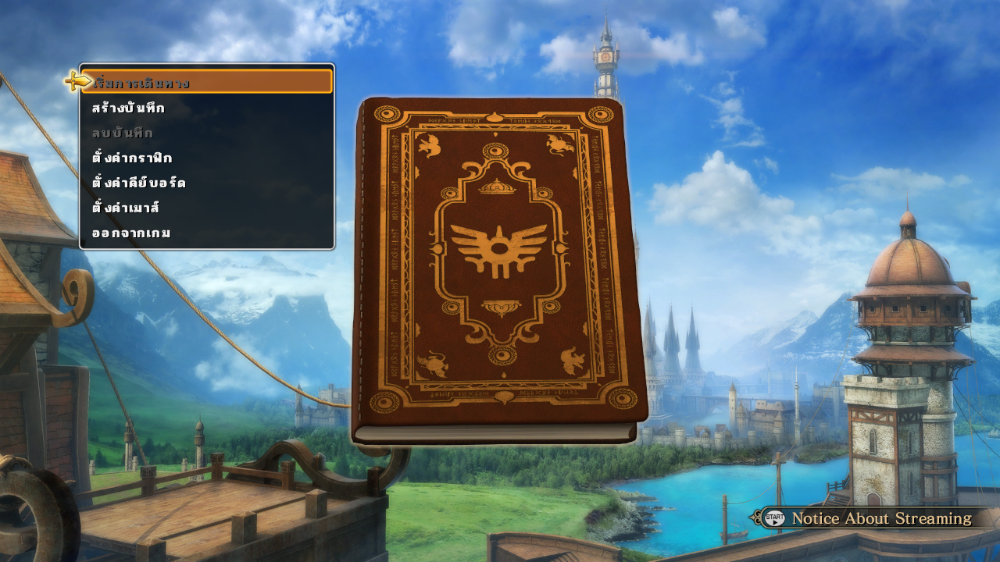

# DRAGON QUEST HEROES™ II - Thai Translation Project (DEMO)

โปรเจกต์ม็อดแปลภาษาไทยสำหรับเกม **DRAGON QUEST HEROES™ II** (PC Steam) โดยอาศัยระบบ **Universal Proportional Typography** บนฟอนต์ `entry_342` และระบบแพ็กเกจหน่วยความจำ `dqh2_font_addons.bin` ผ่าน `dinput8.dll`

> ⚠️ **สถานะโปรเจกต์:** ขณะนี้เป็นเพียงเวอร์ชัน **DEMO (ตัวอย่างทดลองเล่น)**  
> 📢 **โปรดสนับสนุนค่า API และเราจะพัฒนาแปลต่อจนจบทั้งเกม!**  
> 💬 **ช่องทางติดต่อ / สนับสนุน:** [fb.com/stob2013](https://fb.com/stob2013)

---

## 🎮 ภาพตัวอย่างในเกม (DEMO Screenshot)

---

## ความคืบหน้าปัจจุบัน (Current Progress)

### 1. เมนูหลัก Title Screen (100%)
* **เริ่มการเดินทาง** *(Venture Forth)*
* **สร้างบันทึก** *(Create Adventure Log)*
* **ลบบันทึก** *(Delete Adventure Log)*
* **ตั้งค่ากราฟิก** *(Graphics Settings)*
* **ตั้งค่าคีย์บอร์ด** *(Keyboard Settings)*
* **ตั้งค่าเมาส์** *(Mouse Settings)*
* **ออกจากเกม** *(Exit Game)*

### 2. หน้าเลือกผู้กล้า (Hero Selection)
* **ต้องการสร้างบันทึกการเดินทางในช่องใด?** *(Which slot do you want to create an adventure log in?)*
* **เอาล่ะ โปรดเลือกผู้กล้าที่จะควบคุมในการผจญภัยในโลกนี้...** *(Hero selection prompt)*
* **โปรดเลือกผู้กล้า** *(Choose your hero)*
* **ต่อไป โปรดตั้งชื่อให้แก่ผู้กล้าที่จะร่วมเดินทางไปด้วยกัน** *(Name your hero)*

### 3. เมนูตั้งค่ากราฟิก (Graphics Settings)
* แสดงผลเต็มจอ (เปิด / ปิด)
* ความละเอียด / เฟรมเรต (60 / 30 / 20)
* คุณภาพกราฟิก (สูง / กลาง / ต่ำ / กำหนดเอง)
* จำนวนตัวละคร / ระยะแสดงผล / คุณภาพพื้นผิว / คุณภาพเงา / การสะท้อนแสง / ลำแสงส่องกระทบ / ละอองอนุภาค

### 4. ฐานข้อมูลข้อความทั้งเกม (Text Extraction & Translation Database)
* **ดึงข้อความจากเกมครบถ้วน 100%**: ทั้งหมด **51 หมวดหมู่ รวม 49,271 บรรทัด** อยู่ในรูปแบบ CSV ในโฟลเดอร์ `text_csv/`
* **แปลภาษาไทยในระบบแล้ว**: **18,013 บรรทัด (36.6%)** ครอบคลุมเมนู UI ระบบ (88.4%), บทสนทนาหลัก (87.3%), อาวุธ, ชุดเกราะ, มอนสเตอร์ และสกิล

### 5. จุดเด่นของระบบฟอนต์ (Typography Highlights)
* **Proportional Font Width:** ตัวอักษรและสระมีความกว้างตามสัดส่วนจริง (14–23px) ตัวหนังสือชิดกันสวยงาม ไม่มีการบีบ/ยืดภาพ (Zero distortion)
* **Natural Kerning:** สระหน้า (`เ`, `แ`, `โ`, `ใ`, `ไ`) ชิดขวาแนบพยัญชนะตัวถัดไป, สระหลัง (`า`, `ะ`) ชิดซ้ายแนบพยัญชนะตัวหน้า
* **3-Tier Cluster Stacking:** รองรับคลัสเตอร์สระ/วรรณยุกต์ 3 ชั้น (`ตั้`, `ริ่`, `ทึ่`, `สื่`) จัดวางไม้หันอากาศ/สระอิ ซ้อนกับไม้โท/ไม้เอก อย่างประณีต ไม่ทับกันเป็นก้อนและไม่ตกขอบ
* **Non-Destructive Memory Addon:** ใช้งานผ่าน `dinput8.dll` และ `dqh2_font_addons.bin` ไม่แตะต้องหรือแก้ไขไฟล์ `LINKDATA.BIN` บนดิสก์ ปลอดภัย 100%

---

## โครงสร้างโฟลเดอร์ (Folder Structure)

* **`backup/`**: เก็บไฟล์ต้นฉบับแท้ก่อนเริ่มแก้ไข (`entry_204_original.bin`, `entry_341_original.g1t`, `entry_342_original.png`, `LINKDATA.IDX.bak`)
* **`docs/`**: เอกสารและคู่มือทางเทคนิค (.md)
* **`text_csv/`**: ฐานข้อมูลข้อความทั้งเกม 51 หมวดหมู่ (49,271 บรรทัด) พร้อมคอลัมน์คำแปลภาษาไทย
* **`tools/`**: สคริปต์เครื่องมือแปลงไฟล์, ถอดรหัส, และสร้าง Addon
* **`workspace/`**: ไฟล์งานระหว่างดัดแปลงและพรีวิว Font Atlas

---

## เครื่องมือสำคัญใน `tools/`

1. **`build_universal_thai.py`**: สคริปต์หลักสำหรับสร้าง Menu Font Atlas (`entry_342`), แปลงข้อความ UI (`entry_204`), และบรรจุเป็น `dqh2_font_addons.bin`
2. **`dinput8_mod.cpp`**: โค้ดต้นฉบับภาษา C++ สำหรับคอมไพล์เป็น `dinput8.dll` ทำหน้าที่ฮุกไฟล์เกมผ่านแรม และควบคุม Character Width Spacing
3. **`thai_char_widths.inl`**: ตารางความกว้างตัวอักษรภาษาไทยแบบ Proportional สำหรับใช้ใน C++ Hook
4. **`export_all_text_csv.py`**: สคริปต์ดึงข้อความภาษาอังกฤษทั้งหมด 51 หมวดหมู่ (49,271 บรรทัด) จากเกมส่งออกเป็นไฟล์ CSV
5. **`import_all_text_csv.py`**: เครื่องมือนำเข้าข้อความแปลจาก CSV กลับเข้าสู่ระบบ
6. **`g1t_tool.py`**: เครื่องมือถอดและรวมไฟล์ Texture รูปแบบ G1T / DDS ของ Koei Tecmo
7. **`restore_original.py`**: สคริปต์กู้คืนไฟล์ต้นฉบับแท้กลับเข้าเกมได้ทันที

---

## ช่องทางติดต่อและสนับสนุน (Contact & Support)

* **Facebook:** [fb.com/stob2013](https://fb.com/stob2013)

